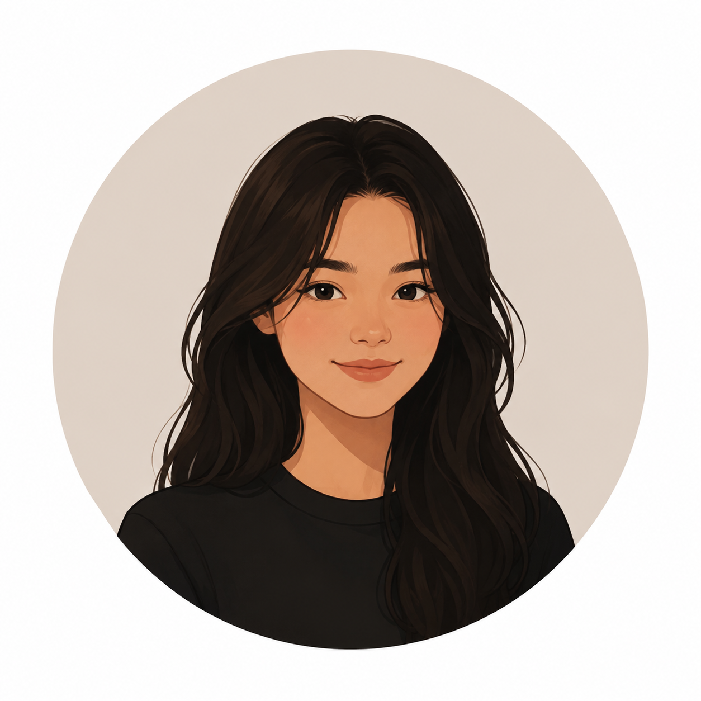

---
layout: hello-default

# using Markdown language, you can customize the following variables!

# these variables are required -------------------------------
banner_title: Areesha Maryam
banner_subtitle: Information Security student | NUST
background_image: /images/background.jpeg

# all of the following variables are optional -----------------
page_url: /hello # only include this variable if you aren't building the page to your primary domain 

# favicon
favicon: /assets/ico/favicon.ico

# social media
github_username: areeshamaryam-am # your github username
linkedin: areesha-maryam-2a1141313 # the part after ("https://www.linkedin.com/in/...")
# facebook_username: <-- your facebook username (the part after "https://www.facebook.com/...")
# google_analytics: <-- your google analytics Tracking ID

# By declaring these variables, you can include a button that links to an external website or to media.
about_button: https://github.com/areeshamaryam-am # the link
about_button_label: my github # the label on the button

# optional portfolio section ------------------------------------------

# By declaring these variables, you can include a portfolio showcasing your work and organize your portfolio's items into a custom layout, all without adding any CSS. In addition, you must 1) create an HTML file in the_includes folder for each project with the text you'd like to display, and 2) create a YAML file in the _data folder describing the order in which each project should be shown and categorized. See `/includes/example.html` and `/_data/work.yml` for examples.

portfolio: work # the heading for your portfolio and title of your YAML file
portfolio_description: "Hands-on labs from my Applications of ICT course."

# optional CTA section --------------------------------------------------

# By declaring these variables, you can include a CTA section.
cta: connect # the heading for your CTA section
cta_description: questions, comments, or concerns? please don't hesitate to reach out. # a description to be desplayed below the heading and above the content
cta_button: mailto:amaryam.beis25mcs@student.nust.edu.pk # a link to an external website or to media
cta_button_label: contact # the label on the button

---			
### about me

I'm Areesha Maryam, a third-semester Bachelor of Engineering student in Information Security at NUST. I'm interested in how systems are built and how they are protected, from cryptography and number theory to the way operating systems store and boot data. So far I have written programs in C++ and Java, practised data structures, and worked through hands-on labs in Kali Linux, CyberChef and Autopsy. I like understanding why a technique works before using it, and I'm building this site to show what I'm learning. I'm looking to grow my skills in digital forensics, secure systems and network security, and I'm always happy to connect with other students and professionals in the field.

**degree:** BE Information Security, 3rd semester, NUST

**skills:** C++, Java (object-oriented programming), basic Linux (Kali Linux), cryptography fundamentals (DES, AES, S-AES, Caesar cipher), data structures and algorithms, digital logic design, basic cybersecurity concepts

*Site template: "hello" by Sara Gong (MIT License), adapted from Twenty by HTML5 UP (CC BY 3.0).*